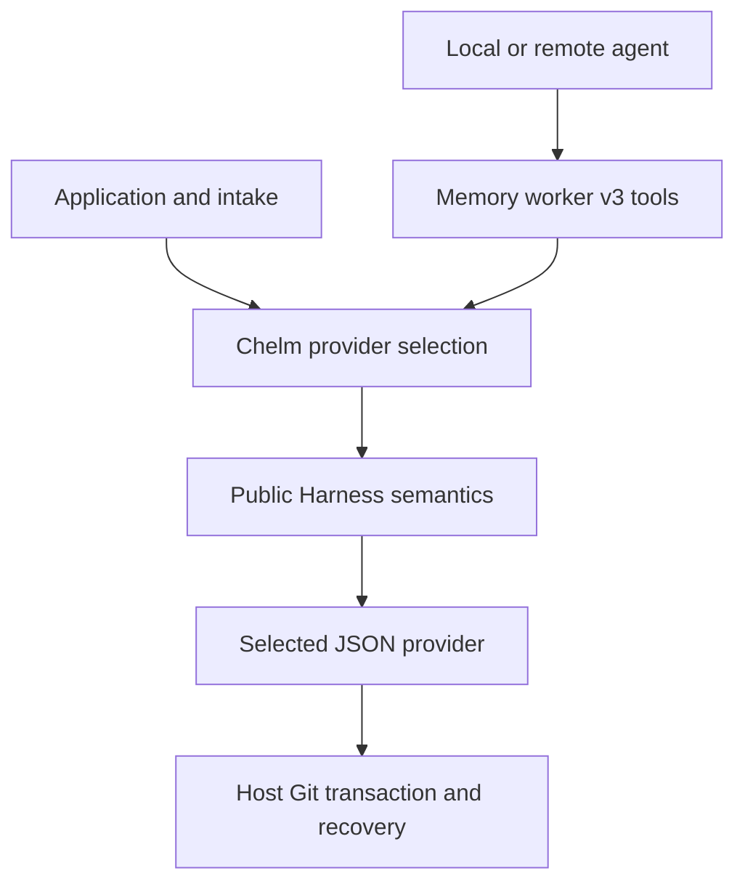

# Host-owned memory providers

Implementation for #32 / #33; Phase A acceptance is tracked by #34. The JSON/Git
provider is implemented and opt-in for vendor development. The merged Harness
provider API is **not present in the published 0.12.0 ZIP**. Its exact unpublished
build is pinned separately in `provider-compatibility.json`. This is not a new
supported published package pair. Normal config-2 runtimes keep the published
package pin in `compatibility.json` unchanged. No release or consumer migration
is performed by this change.

## Ownership and integration

Harness defines logical records, retrieval, evidence/history rules, semantic
changes, validation and portable transfer. Chelm selects one provider, authorizes
an instance scope, owns intake, leases, publication, lifecycle and storage. Agents
receive bounded records/evidence and send semantic operations. They receive no
raw graph or database connection. Inference and scheduling remain external.



The public integration API is version 2, provider/semantic-change contract 1,
logical graph 2, physical JSON storage 2, hypotheses 1, runtime config 3 and memory
worker 3. Existing worker/remote-worker 2 and app/read-model 1 retain their old
meaning. `head` remains the actual Git commit; `snapshot_id` and `policy_id` are
additional explicit fields, never aliases that redefine `head`.

`lib/memory-provider.mjs` is the selection/lifecycle facade. `lib/backend.mjs`
supplies its existing locked Git/CAS/source/policy/index/recovery transaction to
the public `adapters/reference-json/provider.mjs`. Chelm imports public
`server/provider-memory.mjs`, `server/memory-contract.mjs`,
`server/memory-transfer.mjs` and `server/cognitive-reference.mjs` from the verified
package. It neither copies validators nor imports their private implementation.
JSON materialization remains inside the selected JSON adapter. Existing optional
learning uses the provider lifecycle's public transactional learning operation;
it remains separately authorized by the application.

| State | Owner and access |
|---|---|
| Entities, claims, corrections, external IDs, dependencies, processed sources | Canonical provider records, read/changed only through public semantics |
| Source descriptors and original bytes | Snapshot-bound provider records and paged evidence; host intake before claim is explicitly `intake_only` and has no snapshot ID |
| Questions, hypotheses, events, journals, verification, receipts | Canonical provider records, atomically coupled to source completion |
| Existing journals/events/learning receipts and indexed evidence | Preserved exact-byte provider artifacts with original locators; no reset or retrospective verification claims |
| Purpose, profile, vocabulary, retained guidance | Application content, snapshot-pinned provider policy/artifacts; explicit administrative install remains a host lifecycle operation |
| Lease, reservations, authorization, runtime config, assignment uploads | Host operational state; not portable knowledge; no database access from agent input |
| Conversation, tasks, collection requests, intake registry | Host/application state; references remain stable |
| Read models, Markdown/index summaries, statistics | Derived by enumerating provider records during host refresh; committed memory only, with pending host intake labelled separately |
| Merge | Public semantic `rebaseChanges`; conflicts require review and a new upload revision |
| Export | Checksummed portable provider stream, explicit output outside canonical storage, no active-provider switch |
| Initialization, indexing, profile administration, reset/backup | Host JSON lifecycle using existing supported CLI/tools; raw physical handling does not become an agent API |

## Explicit selection without rewriting knowledge

For vendor checks, first build the exact pinned source into a separate package:

```sh
python tools/prepare-provider-harness.py --source /checkout/golem14-harness --destination /tmp/provider-package
node bin/chelm.mjs memory upgrade --runtime /private/runtime --harness /tmp/provider-package/golem-harness
node bin/chelm.mjs memory upgrade --runtime /private/runtime --harness /tmp/provider-package/golem-harness --apply
node bin/chelm.mjs memory status --runtime /private/runtime
```

The source checkout must be clean with full history at the exact commit in the development pin.
Development package identity pins the manifest and every payload hash; ZIP
compression may vary by platform and its observed archive hash is reported.
Published package downloads still require their exact archive hash.
The first upgrade command only audits/plans. Apply requires no active lease,
assignment, dirty instance files or unresolved publication recovery. It audits the
existing immutable snapshot, saves the original config and exact file hashes in
`host/provider-upgrade-v1.json`, and atomically selects `json-git` plus the exact
package path in config 3. It does not change Git HEAD or any instance bytes,
recreate memory, reanalyze sources or enable SQLite. If refresh fails after config
selection, run `refresh` and inspect `memory status`; the instance remains intact.
An interrupted preselection leaves the original config active. Switching a selected
provider by changing a name is refused: no other provider is implemented here.

## Agent contract

Both transports expose `schemas/memory-worker-tools.json`. CLI uses
`chelm memory-worker <operation> --runtime ROOT --input request.json`; local and
remote MCP use `chelm_memory_<operation>`. Remote HTTP retains the existing token
or OAuth authentication and runtime authorization. Local CLI/stdio uses the local
OS actor as its principal. Work IDs and attempt numbers never grant ownership.

Use `prompts/memory-worker-once.sudo.md`, also available as the remote
`chelm_memory_once` prompt. Required protocol artifacts are byte-paged and hashed.
`source` returns exact base64 bytes up to 65,536 per page. `context` uses bounded
Harness semantics; `read` retrieves one exact record. Only `changes.json` is an
output slot. Stage well-formed Unicode in <=32,768-byte UTF-8 chunks, validate and
submit the exact returned manifest digest. The host reparses, prepares and
independently revalidates the final logical candidate at publication. A retained
journal and separate verification pointer, actual declared model, pinned policy,
exact reserved sources, lease and base snapshot are required.

Durable receipts bind intent and logical candidate digests. Receipt and source
completion commit atomically. Unknown submit outcomes use `status`; retries keep
the submission ID/digest fixed. No recovered receipt fabricates a new snapshot ID
from a later head. Response-loss reconciliation repairs the local files/index.
Claim request identity is retained before claiming and bound into the host lease;
a lost claim response recovers the same assignment. A claim with no recoverable
binding fails explicitly and requires a new request ID.

Renewal moves physical HEAD. Use `rebase` with the old staged outputs, inspect its
conflict-checked returned change, stage a new revision, validate and submit again.
It does not publish or silently alter source/policy meaning. Changed policy
requires abandonment, reclaim and review. A definite failed publication with no
receipt permits repair; uncertain recovery retains the frozen submission.
Admin cancellation releases the associated canonical lease. Old graph-editing
workers are refused after provider selection. Cognition uses retained provider
snapshot handles without generating a graph workspace; task semantics remain
owned by the independent cognition contract.

## Capacity, packaging and phase gates

The JSON adapter still parses/scans/rewrites whole files and the first candidate
validator performs a complete paged audit. The Git child output envelope and
logical snapshot budget remain 64 MiB. A synthetic graph over 100 MB is a refusal
case, not supported capacity. Agent output size and host peak RSS are different
measurements; an abstract API does not remove host whole-store costs.

Build both package paths and run the builder with `--provider-harness`:

```sh
CHELM_PROVIDER_HARNESS_ROOT=/tmp/provider-package/golem-harness node --test tests/
python tools/build-release.py --harness /tmp/published/golem-harness --provider-harness /tmp/provider-package/golem-harness
node tools/benchmark-provider.mjs --harness /tmp/published/golem-harness --provider-harness /tmp/provider-package/golem-harness --output provider.json
```

CI checks the same source/package pin on Linux, Windows and macOS. The builder
runs provider conformance against Chelm's transactional store, full regressions,
local/HTTP MCP and cognition checks from the staged host package. A new release
is blocked while `production_enabled` is false. Publish the provider-enabled
Harness first, replace the development pin with its published version/archive/
manifest hashes, update supported compatibility and CI download pins, then rerun
paired/platform acceptance. Never relabel the current 0.12.0 archive.

See `MEMORY_PROVIDER_ACCEPTANCE.md` for observed evidence and remaining gates.
Phase A is independently scoped from optional SQLite #35 and migration #36.
Neither optional phase is implemented or enabled; these cannot block the JSON
architecture implementation, but no migration/cutover acceptance is claimed.
